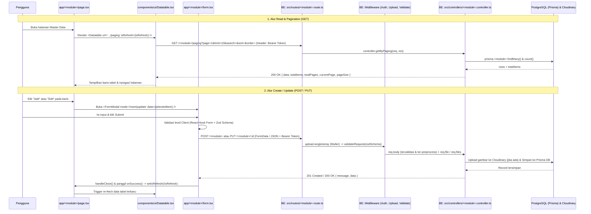

# Standarisasi Pengembangan Frontend — YourSkin (`fe-your-skin`)

Dokumen ini merupakan panduan resmi dan standar arsitektur dalam membangun, memelihara, dan mengembangkan fitur baru pada aplikasi Frontend **YourSkin** (`fe-your-skin`), serta integrasinya dengan Backend (`be-your-skin`).

---

## Daftar Isi

1. [Tech Stack & Environment](#1-tech-stack--environment)
2. [Arsitektur Project & Struktur Direktori](#2-arsitektur-project--struktur-direktori)
3. [Alur Kode End-to-End (Frontend ke Controller Backend)](#3-alur-kode-end-to-end-frontend-ke-controller-backend)
4. [Standarisasi Penamaan (Naming Conventions)](#4-standarisasi-penamaan-naming-conventions)
5. [Standarisasi Autentikasi (Auth Flow)](#5-standarisasi-autentikasi-auth-flow)
6. [Anatomi Component & Shared UI](#6-anatomi-component--shared-ui)
7. [Anatomi Page Master Data (`page.tsx`)](#7-anatomi-page-master-data-pagetsx)
8. [Anatomi Modal Form (`form.tsx`) & Detail (`detail.tsx`)](#8-anatomi-modal-form-formtsx--detail-detailtsx)
9. [Standarisasi Validasi & Semua Tipe Input (Level Schema Zod & HTML/UI)](#9-standarisasi-validasi--semua-tipe-input-level-schema-zod--htmlui)

---

## 1. Tech Stack & Environment

### Core Stack
| Kategori | Teknologi / Library | Versi | Kegunaan |
| :--- | :--- | :--- | :--- |
| **Framework** | Next.js (App Router) | `16.3.8` | Routing berbasis folder (`app/`), Client/Server rendering |
| **UI Library** | React & React DOM | `19.2.8` | Library utama komponen antarmuka |
| **Language** | TypeScript | `^5` | Static typing & ambient global interfaces |
| **Styling** | Tailwind CSS v4 | `^4` | Utility-first styling dengan tema kustom `@theme inline` |
| **Component Kit** | HeroUI (`@heroui/react`) | `^3.2.6` | Komponen UI (`Modal`, `Button`, `TextField`, `Select`, `Chip`, `Checkbox`, `Card`) |
| **Form & Validasi** | `react-hook-form` + `zod` | `^7.89.0` / `^3.25` | State manajemen form terkontrol (`Controller`) & validasi schema via `@hookform/resolvers/zod` |
| **Data Table** | `@tanstack/react-table` | `^8.21.3` | Headless table dengan server-side pagination, sorting, dan pencarian |
| **Drag & Drop** | `@dnd-kit/react` | `^0.5.1` | Pengurutan gambar produk (*sortable drag & drop*) |
| **HTTP Client** | `axios` | `^1.20.0` | Komunikasi REST API ke backend (`JSON` & `multipart/form-data`) |
| **Cookie / Auth** | `js-cookie` | `^3.0.8` | Penyimpanan & pembacaan JWT token di sisi client |
| **Icons** | `lucide-react` | `^1.52.0` | Ikon konsisten di seluruh tabel, tombol, dan form |

### Environment Variables (`.env`)
Setiap environment wajib memiliki variabel berikut:
```env
NEXT_PUBLIC_API_URL='http://localhost:5000'
NEXT_PUBLIC_CLOUDINARY_URL='https://res.cloudinary.com/ogfm8ilm/image/upload/f_auto,q_auto'
```

### Palet Warna & Tema Global (`app/globals.css`)
```css
@import "tailwindcss";
@import "@heroui/styles";

@theme inline {
  --font-sans: var(--font-inter), ui-sans-serif, system-ui, sans-serif;
  --color-skin-blue: #4da9d5;
  --color-skin-sky: #eff8fb;
  --color-skin-blue-tile: #dff0f7;
  --color-skin-pink: #e887ab;
  --color-skin-pink-tile: #f9e6ed;
  --color-skin-pink-band: #fbf4f7;
  --color-skin-green-tile: #e3f2e8;
  --color-skin-sun: #f7e9b9;
  --color-skin-ink: #2b3a55;
  --color-skin-muted: #6b7a8c;
  --color-skin-eyebrow: #5793ae;
}
```
- **Background Halaman Admin**: `bg-[#EFF4F7]`
- **Heading Utama Admin**: `text-[#17324A]`
- **Eyebrow / Sub-label**: `text-[#2F8FB8]` atau `text-skin-blue`
- **Border Input / Card**: `border-[#d9e6ec]` atau `border-[#e6eff2]`

---

## 2. Arsitektur Project & Struktur Direktori

```text
fe-your-skin/
├── app/                          # Next.js App Router
│   ├── auth/                     # Modul Autentikasi
│   │   ├── login/page.tsx        # Halaman Login
│   │   └── register/page.tsx     # Halaman Registrasi
│   ├── brand/                    # Modul Master Data Brand
│   │   ├── page.tsx              # Halaman Tabel Utama Brand
│   │   └── form.tsx              # Modal Form Insert/Update Brand
│   ├── category/                 # Modul Master Data Category
│   │   ├── page.tsx              # Halaman Tabel Utama Category
│   │   └── form.tsx              # Modal Form Insert/Update Category
│   ├── ingredient/               # Modul Master Data Ingredient
│   │   ├── page.tsx              # Halaman Tabel Utama Ingredient
│   │   └── form.tsx              # Modal Form Insert/Update Ingredient
│   ├── product/                  # Modul Master Data Product
│   │   ├── page.tsx              # Halaman Tabel Utama Product
│   │   ├── form.tsx              # Modal Form Insert/Update Product (Multi-image & Ingredients)
│   │   └── detail.tsx            # Modal Read-Only Detail Product
│   ├── catalog/                  # Halaman Publik Katalog Produk
│   │   ├── page.tsx              # Grid Katalog & Filter
│   │   └── [id]/page.tsx         # Halaman Detail Produk Publik
│   ├── globals.css               # Definisi tema Tailwind v4 & HeroUI
│   ├── layout.tsx                # Root Layout
│   └── page.tsx                  # Landing Page Publik
├── components/                   # Komponen Reusable
│   ├── catalog/
│   │   └── ProductCard.tsx       # Kartu produk untuk halaman katalog publik
│   ├── layout/
│   │   ├── Sidebar.tsx           # Navigasi samping halaman Admin/Backoffice
│   │   ├── Navbar.tsx            # Navigasi atas halaman Publik
│   │   └── Footer.tsx            # Footer halaman Publik
│   ├── skeleton/
│   │   ├── TableSkeleton.tsx     # Loading skeleton untuk Datatable
│   │   └── GridSkeleton.tsx      # Loading skeleton untuk Grid Katalog
│   └── ui/
│       ├── Datatable.tsx         # Wrapper TanStack Table + Server Pagination & Search
│       ├── BadgePill.tsx         # Chip status boolean (Active/Not Active, Safe/Not Safe)
│       ├── DynamicSelect.tsx     # Komponen select dinamis
│       └── table.tsx             # Primitif elemen HTML tabel (`Table`, `TableRow`, `TableCell`, dll.)
└── lib/                          # Utilitas, Konstanta & Tipe Global
    ├── constants.ts              # Enum & Array Opsi Statis (`PRODUCT_SCOPE`, `VOLUME_UNITS`, dll.)
    ├── types.d.ts                # Ambient Global Interfaces (`IBrand`, `ICategory`, `IProduct`, dll.)
    └── utils.ts                  # Helper fungsi umum (`cn`, dll.)
```

---

## 3. Alur Kode End-to-End (Frontend ke Controller Backend)

Berikut adalah alur eksekusi data mulai dari interaksi pengguna di Frontend hingga diproses oleh Controller di Backend (`be-your-skin`):



### Kontrak Payload & Response Antara FE dan BE
1. **Endpoint Paging (`GET /<module>/paging`)**:
   - **Query Params dari FE**: `{ page, limit, search, sort, order }`
   - **Response dari BE**:
     ```json
     {
       "message": "Successfully retrieved ...",
       "data": [ ... ],
       "totalItems": 25,
       "totalPages": 3,
       "currentPage": 1,
       "pageSize": 10
     }
     ```
2. **Endpoint Form dengan File Gambar (`POST` / `PUT` menggunakan `FormData`)**:
   - Semua field primitif di-*append* sebagai `String(...)`.
   - Field berupa array atau objek kompleks (seperti `ingredients` atau `images_metadata`) wajib di-*serialize* menggunakan `JSON.stringify(...)` di FE, dan akan di-*parse* otomatis oleh `z.preprocess()` pada [`src/utils/schemas.ts`](file:///d:/PROJECT/YOUR%20SKIN/be-your-skin/src/utils/schemas.ts) di BE.
3. **Endpoint Form Tanpa File (`POST` / `PUT` menggunakan `JSON`)**:
   - Dikirim langsung sebagai objek JavaScript melalui `axios.post(url, payload, { headers })` (contoh: modul `ingredient`).

---

## 4. Standarisasi Penamaan (Naming Conventions)

Agar kode konsisten antara Frontend dan Backend, patuhi aturan penamaan berikut:

| Entitas | Aturan Case | Contoh Benar | Contoh Salah | Lokasi |
| :--- | :--- | :--- | :--- | :--- |
| **Folder Route / Modul** | `kebab-case` / `lowercase` | `app/product/`, `app/category/` | `app/Product/`, `app/MasterCategory/` | `app/` |
| **File Route Next.js** | `lowercase` | `page.tsx`, `form.tsx`, `detail.tsx` | `ProductPage.tsx`, `FormModal.tsx` | `app/<module>/` |
| **File Shared Component** | `PascalCase` | `Datatable.tsx`, `BadgePill.tsx`, `ProductCard.tsx` | `datatable.tsx`, `badge-pill.tsx` | `components/` |
| **Global Interfaces** | `IPascalCase` (Prefix `I`) | `IBrand`, `ICategory`, `IProduct`, `IIngredient` | `BrandType`, `TProduct`, `ProductInterface` | `lib/types.d.ts` |
| **Properti Interface & Form Field** | `snake_case` (Sesuai kolom DB) | `product_name`, `brand_id`, `is_active`, `ph_level` | `productName`, `brandId`, `isActive` | `lib/types.d.ts` & `form.tsx` |
| **Enum** | `PascalCase` (Key `UPPER_CASE`) | `enum ProductScope { FACE = "FACE" }` | `enum product_scope { face = "face" }` | `lib/constants.ts` |
| **Konstanta Global & Opsi** | `UPPER_SNAKE_CASE` | `PRODUCT_SCOPE`, `VOLUME_UNITS`, `EMPTY_VALUES`, `MENU` | `productScopeOptions`, `emptyValues` | `lib/constants.ts` & `page.tsx` |
| **React Component & Props** | `PascalCase` | `FormModal`, `DetailModalProps`, `TogglePill` | `formModal`, `detail_modal_props` | Seluruh `.tsx` |
| **State & Variabel Lokal** | `camelCase` | `isLoading`, `isRefresh`, `selectedItem`, `detailProductId` | `is_loading`, `selected_item` | Seluruh `.tsx` |
| **Event Handlers** | `handle<Action>` / `on<Event>` | `handleClose`, `handleFileChange`, `onSubmit` | `closeModal`, `fileChanged`, `submitForm` | Seluruh `.tsx` |
| **Fungsi Fetch API** | `fetch<Entity>` / `get<Entity>` | `fetchBrands`, `fetchCategories`, `fetchProductDetail` | `load_brands`, `apiBrand` | Seluruh `.tsx` |

> **Catatan Penting:** Gunakan **`snake_case`** untuk semua nama field di dalam skema `zod`, `EMPTY_VALUES`, dan `FormData` agar selalu **1:1 (identik)** dengan nama kolom di `prisma/schema.prisma` dan validator backend.

---

## 5. Standarisasi Autentikasi (Auth Flow)

### 1. Penyimpanan Token Saat Login (`app/auth/login/page.tsx`)
Saat login berhasil, JWT token disimpan ke dalam browser cookie dengan key `"token"` menggunakan `js-cookie`:
```tsx
import Cookies from "js-cookie";

const token =
  response.data?.token ||
  response.data?.data?.token ||
  response.data?.data?.access_token ||
  response.data?.access_token;

if (token) {
  Cookies.set("token", token, { expires: 7 }); // Berlaku 7 hari
}
```

### 2. Pengiriman Header Autentikasi pada Request API
Setiap pemanggilan `axios` (baik `GET`, `POST`, `PUT`, maupun `DELETE`) wajib mengambil token dari `Cookies.get("token")` dan menyertakannya pada header `Authorization`:

```tsx
import axios from "axios";
import Cookies from "js-cookie";

const token = Cookies.get("token");
const headers = {
  ...(token ? { Authorization: `Bearer ${token}` } : {}),
};

// Contoh GET
const res = await axios.get(`${process.env.NEXT_PUBLIC_API_URL}/brand`, { headers });

// Contoh POST / PUT dengan FormData atau JSON
await axios.post(url, body, { headers });
```

---

## 6. Anatomi Component & Shared UI

### A. `<Datatable />` (`components/ui/Datatable.tsx`)
Komponen tabel utama yang menangani *server-side pagination*, *search*, *sorting*, dan *skeleton loading* secara otomatis.
- **Props**:
  ```tsx
  interface DataTableProps<TData = any, TValue = any> {
    columns: ColumnDef<TData, TValue>[]; // Definisi kolom TanStack Table
    url: string;                         // Endpoint paging BE, misal: `${API_URL}/product/paging`
    isRefresh?: boolean;                 // Toggle boolean untuk memicu re-fetch setelah tambah/edit data
  }
  ```

### B. `<BadgePill />` (`components/ui/BadgePill.tsx`)
Komponen standar untuk menampilkan nilai boolean (`is_active`, `is_safe_for_pregnancy`, dll.) di dalam sel tabel.
- **Penggunaan Default (Status Aktif)**:
  ```tsx
  <BadgePill value={row.original.is_active} />
  ```
- **Penggunaan Kustom**:
  ```tsx
  <BadgePill
    value={row.original.is_safe_for_pregnancy}
    trueLabel="Safe"
    falseLabel="Not Safe"
    trueColor="success"
    falseColor="danger"
  />
  ```

### C. Helper Resolusi URL Gambar Cloudinary
Karena gambar di database dapat berupa *path* relatif Cloudinary (contoh: `brand/nfkcl81uq0rmkntzp5kq` atau `/brand/...`) maupun URL penuh (`https://...`), selalu gunakan pola resolusi berikut:
```tsx
const getImageUrl = (path?: string | null): string => {
  if (!path) return "/file.svg";
  if (path.startsWith("http")) return path;
  const cleanPath = path.startsWith("/") ? path.slice(1) : path;
  return `${process.env.NEXT_PUBLIC_CLOUDINARY_URL}/${cleanPath}`;
};
```

---

## 7. Anatomi Page Master Data (`page.tsx`)

Setiap halaman Master Data (`app/<module>/page.tsx`) wajib memiliki struktur anatomi yang seragam:

1. **Deklarasi Client & Konstanta Menu**: `"use client"` di baris pertama dan `const MENU = "NamaModul"`.
2. **State Standar**:
   - `open` (`boolean`): Mengontrol visibilitas modal form.
   - `mode` (`"insert" | "update"`): Menentukan mode tambah atau edit pada modal form.
   - `isRefresh` (`boolean`): Di-toggle (`!isRefresh`) pada `onSuccess` untuk me-refresh `<Datatable />`.
   - `selectedItem` (`IEntity | undefined`): Menyimpan data baris yang sedang diedit.
   - *(Opsional)* `isDetailOpen` & `detailId`: Jika modul memiliki modal detail (`detail.tsx`).
3. **Definisi Kolom (`columns: ColumnDef<IEntity>[]`)**:
   - **Kolom 1 (`No`)**: Menampilkan `row.index + 1`.
   - **Kolom 2 (`Image` / `Icon`)**: *(Jika ada gambar)* Menampilkan thumbnail `rounded-xl`.
   - **Kolom Data Utama**: Menampilkan field dengan `enableSorting: true`.
   - **Kolom Status (`is_active`)**: Menggunakan `<BadgePill value={row.original.is_active} />`.
   - **Kolom `Action`**: Berisi tombol `Detail` (opsional), `Edit`, dan `Deactive` dengan ikon `lucide-react` berukuran `15`.
4. **Layout JSX**:
   - Wrapper `<div className="flex min-h-screen bg-[#EFF4F7]">`
   - `<Sidebar />` di sisi kiri.
   - `<main className="flex-1 px-10 py-10">` berisi Header (`Master Data`, judul `h1`, tombol `+ Add`), `<Datatable />`, `<FormModal />`, dan `<DetailModal />`.

### Template Boilerplate `app/<module>/page.tsx`

```tsx
"use client";

import { useState } from "react";
import { ColumnDef } from "@tanstack/react-table";
import { Button } from "@heroui/react";
import * as Icon from "lucide-react";
import Datatable from "@/components/ui/Datatable";
import Sidebar from "@/components/layout/Sidebar";
import BadgePill from "@/components/ui/BadgePill";
import FormModal from "@/app/category/form";

const MENU = "Category";

export default function CategoryPage() {
  const [open, setOpen] = useState(false);
  const [mode, setMode] = useState<"insert" | "update">("insert");
  const [isRefresh, setIsRefresh] = useState(false);
  const [selectedItem, setSelectedItem] = useState<ICategory>();

  const columns: ColumnDef<ICategory>[] = [
    {
      accessorKey: "",
      header: "No",
      cell: ({ row }) => <div>{row.index + 1}</div>,
    },
    {
      accessorKey: "icon",
      header: "Icon",
      enableSorting: false,
      cell: ({ row }) => {
        const icon = row.original.icon;
        if (!icon) {
          return (
            <div className="h-10 w-10 flex items-center justify-center rounded-xl bg-gray-100 text-gray-400">
              <Icon.Layers size={18} />
            </div>
          );
        }
        const cleanPath = icon.startsWith("/") ? icon.slice(1) : icon;
        const src = icon.startsWith("http")
          ? icon
          : `${process.env.NEXT_PUBLIC_CLOUDINARY_URL}/${cleanPath}`;
        return (
          
        );
      },
    },
    {
      accessorKey: "name",
      header: "Category Name",
      enableSorting: true,
    },
    {
      accessorKey: "is_active",
      header: "Status",
      enableSorting: true,
      cell: ({ row }) => <BadgePill value={row.original.is_active} />,
    },
    {
      accessorKey: "",
      header: "Action",
      cell: ({ row }) => {
        const data = row.original;
        return (
          <div className="flex items-center justify-center gap-1.5">
            <Button
              variant="secondary"
              size="sm"
              onPress={() => {
                setSelectedItem(data);
                setMode("update");
                setOpen(true);
              }}
              className="gap-1.5 rounded-xl font-medium"
            >
              <Icon.Pencil size={15} />
              Edit
            </Button>
            <Button
              variant="danger-soft"
              size="sm"
              className="gap-1.5 rounded-xl font-medium"
            >
              <Icon.Power size={15} />
              Deactive
            </Button>
          </div>
        );
      },
    },
  ];

  return (
    <div className="flex min-h-screen bg-[#EFF4F7]">
      <Sidebar />

      {/* --- Main Content --- */}
      <main className="flex-1 px-10 py-10">
        <div className="mb-8 flex items-start justify-between gap-4">
          <div>
            <span className="text-xs font-bold uppercase tracking-widest text-[#2F8FB8]">
              Master Data
            </span>
            <h1 className="mt-1 text-5xl font-extrabold text-[#17324A]">{MENU}</h1>
            <p className="mt-2 text-gray-500">
              Kelola data {MENU.toLowerCase()} untuk sistem katalog YourSkin.
            </p>
          </div>
          <Button
            onPress={() => {
              setSelectedItem(undefined);
              setMode("insert");
              setOpen(true);
            }}
            className="shrink-0 gap-2 rounded-full bg-[#4A9CC7] px-6 py-3 font-bold text-white hover:bg-[#3f8fb8]"
          >
            <Icon.Plus size={18} />
            Add {MENU}
          </Button>
        </div>

        {/* --- DataTable --- */}
        <Datatable
          columns={columns}
          isRefresh={isRefresh}
          url={`${process.env.NEXT_PUBLIC_API_URL}/category/paging`}
        />

        {/* --- Form Modal --- */}
        <FormModal
          url={
            mode === "insert"
              ? `${process.env.NEXT_PUBLIC_API_URL}/category`
              : `${process.env.NEXT_PUBLIC_API_URL}/category/${selectedItem?.id}`
          }
          mode={mode}
          isOpen={open}
          data={mode === "update" ? selectedItem : null}
          onOpenChange={(isOpen) => {
            setOpen(isOpen);
            if (!isOpen) setSelectedItem(undefined);
          }}
          onSuccess={() => setIsRefresh(!isRefresh)}
        />
      </main>
    </div>
  );
}
```

---

## 8. Anatomi Modal Form (`form.tsx`) & Detail (`detail.tsx`)

### Struktur Props Standar `FormModalProps`
Semua komponen `form.tsx` wajib menerima props standar berikut:
```tsx
interface FormModalProps {
  url: string;
  mode: "insert" | "update";
  data?: IEntity | null;
  isOpen: boolean;
  onOpenChange: (isOpen: boolean) => void;
  onSuccess?: () => void;
}
```

### Siklus Hidup (`useEffect`) di dalam `form.tsx`
1. **Fetch Data Referensi (Relasi)** ketika modal dibuka (`if (!isOpen) return;`).
2. **Populasi Nilai Edit (`setValue`)** ketika prop `data` berubah pada mode `"update"`.
3. **Reset Form (`reset(EMPTY_VALUES)`)** setiap kali modal ditutup (`if (!isOpen) reset(EMPTY_VALUES)`).

### Struktur Anatomi Komponen HeroUI `Modal`
```tsx
<Modal.Backdrop
  isOpen={isOpen}
  onOpenChange={(open) => (open ? onOpenChange(true) : handleClose())}
>
  <Modal.Container placement="center">
    <Modal.Dialog className="sm:max-w-xl max-h-[90vh] overflow-y-auto rounded-3xl">
      <Modal.CloseTrigger />
      <Modal.Header className="flex items-center gap-3">
        <div className="flex h-10 w-10 shrink-0 items-center justify-center rounded-2xl bg-skin-sky text-skin-blue">
          <Sparkles size={18} />
        </div>
        <div>
          <Modal.Heading>
            <span className="text-xs font-bold uppercase tracking-widest text-skin-blue">
              {mode === "insert" ? "Add Entity" : "Edit Entity"}
            </span>
          </Modal.Heading>
        </div>
      </Modal.Header>

      <Modal.Body>
        <form id="entity-form" className="flex flex-col gap-4" onSubmit={handleSubmit(onSubmit)}>
          {/* Field inputs berada di sini */}
        </form>
      </Modal.Body>

      <Modal.Footer>
        <Button
          type="button"
          variant="secondary"
          onPress={handleClose}
          className="rounded-xl transition active:scale-[0.97]"
        >
          <X size={16} /> Cancel
        </Button>
        <Button
          type="submit"
          form="entity-form"
          isDisabled={isLoading}
          className="rounded-xl bg-skin-blue text-white transition active:scale-[0.97]"
        >
          <Check size={16} /> {isLoading ? "Saving..." : "Save"}
        </Button>
      </Modal.Footer>
    </Modal.Dialog>
  </Modal.Container>
</Modal.Backdrop>
```

---

## 9. Standarisasi Validasi & Semua Tipe Input (Level Schema Zod & HTML/UI)

Seluruh form wajib menerapkan **validasi berlapis**:
1. **Level Schema (Zod)**: Didefinisikan di atas komponen menggunakan `zod` dan dihubungkan ke `useForm` melalui `resolver: zodResolver(schema)`.
2. **Level HTML / UI Component (HeroUI + React Hook Form `Controller`)**: Menampilkan state invalid (`isInvalid={!!errors.field}`), atribut batasan HTML (`min`, `max`, `step`, `accept`), dan pesan error (`<FieldError>`).

Berikut adalah standarisasi untuk **9 tipe input** yang digunakan di seluruh aplikasi:

---

### 9.1. Input Teks Standar (String)

- **Level Schema (Zod)**:
  ```tsx
  name: z
    .string()
    .trim()
    .min(2, "Nama minimal 2 karakter")
    .max(100, "Maksimal 100 karakter"),
  ```
- **Level HTML / Component**:
  ```tsx
  <TextField isInvalid={!!errors.name}>
    <Label>Nama</Label>
    <Controller
      name="name"
      control={control}
      render={({ field }) => (
        <Input
          {...field}
          className="rounded-xl"
          placeholder="Contoh: Niacinamide"
        />
      )}
    />
    <FieldError>{errors.name?.message as string | undefined}</FieldError>
  </TextField>
  ```

---

### 9.2. Input Email & Password (Auth)

- **Level Schema (Zod)**:
  ```tsx
  email: z.string().trim().email("Format email tidak valid"),
  password: z.string().min(6, "Password minimal 6 karakter"),
  ```
- **Level HTML / Component**:
  ```tsx
  <TextField isInvalid={!!errors.email} className="flex flex-col gap-2">
    <Label className="text-[#6c8c9f] font-bold text-sm">Email</Label>
    <Controller
      name="email"
      control={control}
      render={({ field }) => (
        <Input
          {...field}
          type="email"
          placeholder="you@example.com"
          className="w-full bg-[#f4f8fa] border border-[#d6e4ec] rounded-2xl px-4 py-3.5 text-sm"
        />
      )}
    />
    <FieldError className="text-xs text-red-500">{errors.email?.message}</FieldError>
  </TextField>
  ```

---

### 9.3. Input Angka / Numerik (Integer & Desimal/Float)

- **Level Schema (Zod)**:
  Gunakan `z.coerce.number()` agar nilai dari input HTML dapat dikonversi ke tipe `number` dan divalidasi rentangnya:
  ```tsx
  // Contoh Integer (Rating 0 - 5)
  comedogenic_rating: z.coerce
    .number({ invalid_type_error: "Rating harus berupa angka" })
    .int("Harus bilangan bulat")
    .min(0, "Rating minimal 0")
    .max(5, "Rating maksimal 5"),

  // Contoh Float/Desimal (pH Level 0 - 14)
  ph_level: z.coerce
    .number({ invalid_type_error: "pH harus berupa angka" })
    .min(0, "pH minimal 0")
    .max(14, "pH maksimal 14"),
  ```
- **Level HTML / Component**:
  Sertakan atribut `type="number"`, `min`, `max`, dan `step` (`"1"` untuk integer, `"0.1"` atau `"0.01"` untuk desimal):
  ```tsx
  <TextField isInvalid={!!errors.ph_level}>
    <Label>pH Level</Label>
    <Controller
      name="ph_level"
      control={control}
      render={({ field }) => (
        <Input
          {...field}
          type="number"
          min="0"
          max="14"
          step="0.1"
          className="rounded-xl"
          placeholder="5.5"
          onChange={(e) =>
            field.onChange(
              e.target.value === "" ? "" : Number(e.target.value)
            )
          }
        />
      )}
    />
    <FieldError>{errors.ph_level?.message as string | undefined}</FieldError>
  </TextField>
  ```
- **Pengiriman ke `FormData`**:
  Pastikan tidak mengirim string `"undefined"` atau `"null"`:
  ```tsx
  if (values.ph_level !== undefined && values.ph_level !== null && !Number.isNaN(values.ph_level)) {
    body.append("ph_level", String(values.ph_level));
  }
  ```

---

### 9.4. Input Boolean / Checkbox Toggle (`TogglePill`)

- **Level Schema (Zod)**:
  ```tsx
  is_active: z.boolean(),
  is_fragrance_free: z.boolean(),
  ```
- **Level HTML / Component**:
  Gunakan sub-komponen standar `TogglePill` berbasis `<Checkbox>` HeroUI:
  ```tsx
  <Controller
    control={control}
    name="is_active"
    render={({ field }) => (
      <TogglePill
        icon={<Zap size={16} />}
        label="Active Status"
        isSelected={field.value}
        onChange={field.onChange}
      />
    )}
  />
  ```
  **Definisi Sub-Komponen `TogglePill`**:
  ```tsx
  function TogglePill({
    icon,
    label,
    isSelected,
    onChange,
  }: {
    icon: React.ReactNode;
    label: string;
    isSelected: boolean;
    onChange: (value: boolean) => void;
  }) {
    return (
      <Checkbox isSelected={isSelected} onChange={onChange} className="w-full">
        <Checkbox.Content
          className={`flex w-full items-center gap-2 rounded-2xl border px-3.5 py-2.5 text-sm font-medium transition ${
            isSelected
              ? "border-skin-blue bg-skin-sky text-skin-ink"
              : "border-[#d9e6ec] bg-white text-skin-muted"
          }`}
        >
          <span className={isSelected ? "text-skin-blue" : "text-skin-muted"}>
            {icon}
          </span>
          {label}
        </Checkbox.Content>
      </Checkbox>
    );
  }
  ```

---

### 9.5. Input Single Select / Dropdown (Konstanta Statis & Relasi API)

- **Level Schema (Zod)**:
  ```tsx
  brand_id: z.string().trim().min(1, "Brand wajib dipilih"),
  volume_unit: z.string().trim().min(1, "Satuan volume wajib dipilih"),
  ```
- **Level HTML / Component**:
  Menggunakan `<Select>` dan `<ListBox>` dari `@heroui/react`:
  ```tsx
  <div className="flex flex-col gap-2">
    <Label className="text-sm font-medium">Brand</Label>
    <Controller
      name="brand_id"
      control={control}
      render={({ field }) => (
        <Select
          aria-label="Brand"
          className="w-full"
          placeholder="Pilih Brand"
          value={field.value || null}
          onChange={(val) => field.onChange(val ? String(val) : "")}
        >
          <Select.Trigger className="rounded-xl border border-[#d9e4e9] bg-white px-3 flex items-center">
            <Select.Value />
            <Select.Indicator />
          </Select.Trigger>
          <Select.Popover>
            <ListBox aria-label="Daftar Brand">
              {brands.map((brand) => (
                <ListBox.Item
                  key={brand.id}
                  id={brand.id!}
                  textValue={brand.name}
                >
                  {brand.name}
                  <ListBox.ItemIndicator />
                </ListBox.Item>
              ))}
            </ListBox>
          </Select.Popover>
        </Select>
      )}
    />
    {errors.brand_id && (
      <FieldError>{errors.brand_id?.message as string | undefined}</FieldError>
    )}
  </div>
  ```

---

### 9.6. Input Multiple Select / Array of Strings (Tags / Conditions)

- **Level Schema (Zod)**:
  ```tsx
  target_conditions: z
    .array(z.string())
    .min(1, "Pilih minimal 1 target condition"),
  ```
- **Level HTML / Component**:
  Menggunakan `<Select selectionMode="multiple">` dengan tampilan item terpilih berupa `<Chip>`:
  ```tsx
  <div className="flex flex-col gap-2">
    <Label className="text-sm font-medium">Target Conditions</Label>
    <Controller
      name="target_conditions"
      control={control}
      render={({ field }) => (
        <Select<any, "multiple">
          aria-label="Target Conditions"
          className="w-full"
          selectionMode="multiple"
          placeholder="Pilih Target Conditions"
          value={field.value || []}
          onChange={(val) => {
            field.onChange(
              Array.isArray(val)
                ? val.map(String)
                : val
                ? [String(val)]
                : []
            );
          }}
        >
          <Select.Trigger className="rounded-xl border border-[#d9e4e9] bg-white px-3 min-h-10 flex items-center">
            <Select.Value className="flex flex-wrap gap-1.5 py-1">
              {({ isPlaceholder, state }) => {
                if (isPlaceholder) {
                  return (
                    <span className="text-gray-400 text-sm">
                      Pilih Target Conditions
                    </span>
                  );
                }
                return (
                  <div className="flex flex-wrap gap-1.5 py-0.5">
                    {state.selectedItems.map((item) => (
                      <Chip key={item.key} size="sm" variant="secondary" className="text-xs">
                        {item.textValue || String(item.rendered)}
                      </Chip>
                    ))}
                  </div>
                );
              }}
            </Select.Value>
            <Select.Indicator />
          </Select.Trigger>
          <Select.Popover>
            <ListBox aria-label="Daftar Target Conditions">
              {TARGET_CONCERNS.map((item) => (
                <ListBox.Item key={item} id={item} textValue={item}>
                  {item}
                  <ListBox.ItemIndicator />
                </ListBox.Item>
              ))}
            </ListBox>
          </Select.Popover>
        </Select>
      )}
    />
    {errors.target_conditions && (
      <FieldError>{errors.target_conditions?.message as string | undefined}</FieldError>
    )}
  </div>
  ```

---

### 9.7. Input Single File Upload (Logo Brand / Icon Kategori)

- **Level Schema (Zod)**:
  ```tsx
  image: z.instanceof(FileList).optional(),
  ```
- **Level HTML / Component (`FileDropLabel`)**:
  Menampilkan preview gambar saat ini pada mode `"update"` dan menyediakan area klik/drop untuk memilih file baru:
  ```tsx
  <div className="flex flex-col gap-1.5">
    <Label>Icon / Gambar</Label>
    {data?.icon && (
      <div className="mb-2 flex items-center gap-3 p-2 border border-[#d9e6ec] rounded-xl bg-skin-sky/10">
        
        <div className="text-xs text-skin-muted">
          <p className="font-medium text-skin-ink">Gambar saat ini</p>
          <p>Pilih file baru di bawah jika ingin mengganti</p>
        </div>
      </div>
    )}
    <Controller
      name="icon"
      control={control}
      render={({ field }) => (
        <FileDropLabel
          fileName={(field.value as FileList | undefined)?.[0]?.name ?? null}
          onChange={(files) => field.onChange(files ?? undefined)}
          onBlur={field.onBlur}
        />
      )}
    />
    {errors.icon && (
      <FieldError>{errors.icon?.message as string | undefined}</FieldError>
    )}
  </div>
  ```
- **Pengiriman ke `FormData`**:
  ```tsx
  if (values.icon?.[0]) {
    body.append("icon", values.icon[0]);
  }
  ```

---

### 9.8. Input Multi-File Upload + Drag & Drop Reordering (`@dnd-kit/react`)

Digunakan pada modul dengan banyak gambar yang memiliki urutan tampilan (`display_order`), seperti `ProductImage`:

- **State Management**:
  ```tsx
  const [productImages, setProductImages] = useState<IProductImage[]>([]);
  ```
- **Handler Tambah File & Hapus Gambar**:
  ```tsx
  const handleFileChange = (e: React.ChangeEvent<HTMLInputElement>) => {
    if (!e.target.files) return;
    const selectedFiles = Array.from(e.target.files);
    const newImages: IProductImage[] = selectedFiles.map((file, idx) => ({
      id: `new_${Date.now()}_${idx}`,
      image_url: URL.createObjectURL(file),
      display_order: productImages.length + idx + 1,
      file,
    }));
    setProductImages((prev) => [...prev, ...newImages]);
    e.target.value = "";
  };

  const handleRemoveImage = (targetId: string | number) => {
    setProductImages((prev) =>
      prev
        .filter((img) => (img.id ?? img.display_order) !== targetId)
        .map((img, idx) => ({ ...img, display_order: idx + 1 }))
    );
  };
  ```
- **Pengiriman ke Backend (`FormData` + `images_metadata`)**:
  ```tsx
  // 1. Append file fisik untuk gambar baru
  productImages.forEach((img) => {
    if (img.file) {
      body.append("images", img.file);
    }
  });

  // 2. Append metadata urutan untuk sinkronisasi penuh di Backend
  const imagesMetadata = productImages.map((img) => ({
    id: img.id,
    display_order: img.display_order,
    image_url: img.image_url,
    is_new: !!img.file,
  }));
  body.append("images_metadata", JSON.stringify(imagesMetadata));
  ```

---

### 9.9. Input Dynamic Array of Objects Builder (Contoh: Komposisi Bahan Aktif Produk)

Untuk relasi *many-to-many* dengan atribut tambahan (seperti `ingredient_id`, `concentration_percentage`, `order_in_formula`):

- **State & Validasi Lokal**:
  ```tsx
  const [productIngredients, setProductIngredients] = useState<IProductIngredient[]>([]);
  const [selectedIngredientId, setSelectedIngredientId] = useState<string>("");
  const [ingredientPercentage, setIngredientPercentage] = useState<string>("");
  const [ingredientError, setIngredientError] = useState<string>("");

  const handleAddProductIngredient = () => {
    if (!selectedIngredientId) {
      setIngredientError("Pilih ingredient terlebih dahulu");
      return;
    }
    const exists = productIngredients.some(
      (item) => String(item.ingredient_id) === String(selectedIngredientId)
    );
    if (exists) {
      setIngredientError("Ingredient sudah ditambahkan");
      return;
    }
    const pct = ingredientPercentage === "" ? 0 : Number(ingredientPercentage);
    if (Number.isNaN(pct) || pct < 0 || pct > 100) {
      setIngredientError("Persentase harus antara 0 - 100%");
      return;
    }

    setProductIngredients((prev) => [
      ...prev,
      {
        ingredient_id: selectedIngredientId,
        concentration_percentage: pct,
        is_key_active: pct >= 1,
        order_in_formula: prev.length + 1,
      },
    ]);
    setSelectedIngredientId("");
    setIngredientPercentage("");
    setIngredientError("");
  };
  ```
- **Pengiriman ke Backend**:
  ```tsx
  body.append("ingredients", JSON.stringify(productIngredients));
  ```

---

## Checklist Pembuatan Modul Baru di Frontend

Setiap kali membuat modul Master Data baru (misal: `interaction` atau `consultation`):
1. [ ] Tambahkan interface `I<Module>` di [`lib/types.d.ts`](file:///d:/PROJECT/YOUR%20SKIN/fe-your-skin/lib/types.d.ts) dengan nama properti `snake_case`.
2. [ ] Tambahkan enum/konstanta opsi statis (jika ada) di [`lib/constants.ts`](file:///d:/PROJECT/YOUR%20SKIN/fe-your-skin/lib/constants.ts).
3. [ ] Buat folder `app/<module>/` berisi `page.tsx`, `form.tsx`, dan opsional `detail.tsx`.
4. [ ] Gunakan `<Datatable />` dengan endpoint `/<module>/paging` dan `<BadgePill />` untuk kolom boolean.
5. [ ] Gunakan `zodResolver(schema)` + `Controller` pada `form.tsx`, serta sertakan header `Authorization: Bearer ${token}` dari `Cookies.get("token")`.
6. [ ] Daftarkan menu navigasi baru pada [`components/layout/Sidebar.tsx`](file:///d:/PROJECT/YOUR%20SKIN/fe-your-skin/components/layout/Sidebar.tsx).

